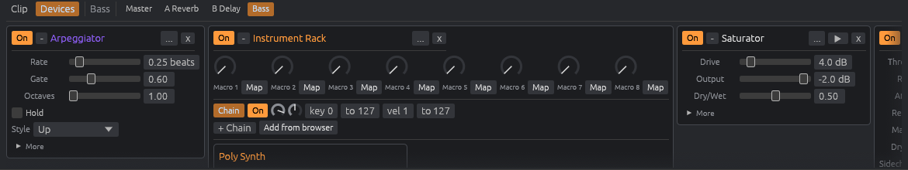

# LoopCraft

**A clip-launching digital audio workstation; an open-source, clean-room take on the Ableton Live workflow, built in pure Rust.**

Session-view clip launching with follow actions, an Arrangement timeline with automation, MIDI and audio recording, warped audio in five modes, 37 built-in instruments and effects, racks with macros, MIDI and key mapping, and CLAP and VST3 plugin hosting with editor windows. It's a native app written entirely in Rust: open source, offline, and yours.


> **Status: v0.3. It covers most of Live's core workflow, but it's not a Live replacement.** Everything below is implemented and covered by 159 automated tests, including a check that renders every built-in device through the engine. **None of it has been tested on real audio or MIDI hardware yet.** It was built on a machine with neither, so latency, driver behaviour and controller handling on real devices are unverified. The [roadmap](docs/ROADMAP.md) lists every feature with its status, including what's missing (Audio Units, plugin editors on Windows and macOS, control-surface scripts and more). The plugin host has only been tested with the small test plugins in this repo, not with commercial plugins.

LoopCraft is not affiliated with, endorsed by, or derived from Ableton AG. "Ableton" and "Live" are trademarks of Ableton AG and are used here only to describe the workflow LoopCraft is compatible with. See [docs/CLEAN_ROOM.md](docs/CLEAN_ROOM.md).

---

## What works today

**Session view.** Quantized, sample-accurate clip and scene launching, with per-scene tempo and time signature. Launch modes are Trigger, Gate and Toggle. Clips and scenes have follow actions (A/B choices with chance, linked, jump). Group tracks fold, and their slots launch the whole row. You can copy, paste and duplicate clips.

**Recording.** Arm tracks and click an empty slot, or use Session Record. MIDI overdubs onto a playing clip. Audio records from interface inputs or from other tracks and the master (resampling). Arrangement Record captures onto the timeline and overwrites what it covers, and also writes Session clip launches into the Arrangement. Loop recording keeps every pass as a take lane you can comp from. Capture MIDI turns what you just played, even with the transport stopped, into a clip. Count-in and quantized start/stop are supported.

**Arrangement view.** Regions can be moved across tracks, resized, trimmed from either edge, split, duplicated and consolidated. You can insert or delete time. There are automation lanes for every mixer and device parameter (built-in and plugin), a tempo-automation lane, locators, a loop brace, and follow-playhead scrolling.

**Audio.** Five warp modes:
- **Beats:** transient slices.
- **Stretch:** WSOLA.
- **Complex:** phase-locked vocoder.
- **Repitch** and **Off.**

Clips also support warp markers, transpose, gain, reverse and fades. Import reads WAV, AIFF, FLAC, MP3 and Ogg.

**MIDI.** The piano roll has multi-note selection (shift-click, marquee, select all), copy / paste / duplicate, arrow-key nudge and transpose, Fold, scale highlighting with snap-to-scale, a velocity lane, per-note chance, quantize, transpose, duplicate loop and a groove pool. MIDI effects: Arpeggiator, Chord, Scale, Random, Note Length, Velocity, Pitch. Hardware MIDI input works, and the computer keyboard doubles as a piano.

**Instruments.** Poly Synth, Wavetable, 4-operator FM Synth, Sampler, Multi Sampler, Drum Rack, Instrument Rack (key and velocity zones, 8 macros).

**Audio effects:**
- **Dynamics:** EQ, Compressor (sidechain), Glue Compressor, Limiter, Gate, Multiband Dynamics.
- **Space:** Delay, Reverb, Convolution Reverb.
- **Character:** Saturator, Drum Buss, Amp + cabinet, Redux.
- **Modulation and filters:** Chorus, Flanger, Phaser, Auto Pan, Auto Filter.
- **Creative:** Beat Repeat, Grain Delay, Vocoder.
- **Utility and routing:** Utility, Audio Effect Rack.

**Mixer and routing.** Volume, pan, pre- or post-fader sends to returns (returns can feed later returns), groups, track outputs routed to any other track (or sends only), track inputs and monitoring, a crossfader with A/B assignment, cue on outputs 3/4, and automatic delay compensation (including inside racks and for plugins).

**Control.** MIDI Map and Key Map modes, macro mapping, tap tempo.

**Plugins.** CLAP and VST3 hosting: scanning, audio, notes, parameters (editable, automatable, mappable, and kept in sync with edits made in the plugin's own editor), the plugin's internal state saved with the project, and latency compensation. Editor windows open embedded on Linux (X11). Running instances survive edits elsewhere in the project. Not yet supported: embedded editors on Windows and macOS, Audio Units, sidechain inputs.

**Files.** `.loopcraft` projects, recent files, Collect All and Save, undo/redo, device presets. Export to WAV (16/24/32-bit float), FLAC or AIFF at 44.1–96 kHz, optionally as stems. Audio and MIDI settings live in their own window.




## Try it

You need a recent Rust toolchain (1.85+). On Linux you also need ALSA headers (`libasound2-dev` on Debian/Ubuntu).

```sh
git clone https://github.com/loopcraft/loopcraft
cd loopcraft

# The desktop app. With no argument it opens the demo song.
cargo run --release -p loopcraft-app

# Command-line tools
cargo run --release -p loopcraft-cli -- demo ./demo
cargo run --release -p loopcraft-cli -- render demo/night-drive.loopcraft -o night-drive.wav --scenes 0:16,1:16,2:32,3:16
cargo run --release -p loopcraft-cli -- render demo/night-drive.loopcraft -o arrangement.wav --arrangement
cargo run --release -p loopcraft-cli -- info demo/night-drive.loopcraft
cargo run --release -p loopcraft-cli -- plugins
```

The demo song ("Night Drive", 124 bpm) is synthesized entirely by the engine: drums from the Drum Rack, bass ducked by the kick through sidechain compression, an auto-filtered pad on a reverb send, a lead on a delay send, and a 100 bpm drum break time-stretched to the song tempo. Its last scene drops the tempo to 118 bpm to show warping following a tempo change.

### Keyboard

| Key | Action |
|---|---|
| Space | Play / stop (Stop twice returns to the start) |
| Tab | Switch Session / Arrangement |
| A W S E D F T G Y H U J K | Play armed MIDI tracks (or the selected one) like a piano |
| Z / X, C / V | Octave down / up, velocity down / up |
| ↑ / ↓, Enter | Select a scene, launch it and move to the next |
| F9 | Arrangement Record |
| Delete | Delete the selected note or clip |
| Ctrl+C / Ctrl+V | Copy / paste a clip |
| Ctrl+D | Duplicate clip (next slot, or after the region) |
| Ctrl+E | Split the selected region at the playhead |
| Ctrl+G | Group selected tracks (Ctrl/Shift-click headers to select several) |
| Ctrl+T / Ctrl+Shift+T | New audio / MIDI track |
| Ctrl+M / Ctrl+K | MIDI Map / Key Map mode (Esc to leave) |
| Ctrl+Z / Ctrl+Shift+Z | Undo / redo |
| Ctrl+S / Ctrl+Shift+S / Ctrl+O / Ctrl+N | Save / save as / open / new |
| Ctrl+, | Settings |

## How it's built

LoopCraft is a Cargo workspace of small crates, each usable on its own:

| Crate | What it does |
|---|---|
| `loopcraft-core` | Musical time, quantization and the project model / file format. No audio dependencies. |
| `loopcraft-dsp` | Instruments, MIDI and audio effects, racks, the time-stretchers. Real-time safe. |
| `loopcraft-engine` | The audio graph: transport, launching, follow actions, recording, arrangement, automation, mixer, delay compensation. Lock-free control from the UI. |
| `loopcraft-io` | Audio and MIDI files, offline rendering and stems, the demo song. |
| `loopcraft-plugin` | CLAP and VST3 hosting (audio, notes, parameters, state, latency, editor windows). |
| `loopcraft-cli` | `loopcraft` command-line tool. |
| `loopcraft-app` | The desktop app (egui + cpal + midir). |

The audio thread never allocates, locks or frees memory: commands arrive through a wait-free ring buffer, replaced objects are shipped back to the UI thread to be dropped, and each block is split exactly at musical boundaries so launches land on the sample. Details in [docs/ARCHITECTURE.md](docs/ARCHITECTURE.md).

Run the tests with `cargo test`. The suite renders real audio and checks it: that a launch lands on beat 4 to the sample, that Stretch keeps a 220 Hz tone at 220 Hz at double speed, that a closed hat chokes an open hat, that CLAP and VST3 plugins built from the repo process audio inside the engine with their saved parameters, state and reported latency, and that their editors run on the host's event loop and report edits back, and that splitting, trimming and recording leave the project consistent.

## Contributing

Contributions are welcome; see [CONTRIBUTING.md](CONTRIBUTING.md) and pick something from the [roadmap](docs/ROADMAP.md). The one hard rule is the clean-room rule: never use Ableton's code, binaries, assets, or reverse-engineered internals.

## License

Licensed under either of [Apache License 2.0](LICENSE-APACHE) or [MIT license](LICENSE-MIT) at your option. Unless you state otherwise, any contribution you submit for inclusion is dual-licensed as above, without additional terms.

Project structure, licensing and the clean-room approach follow the model of the [ArtCraft](https://github.com/storytold/artcraft) Crafting Apps. LoopCraft is an independent project and not part of ArtCraft.
