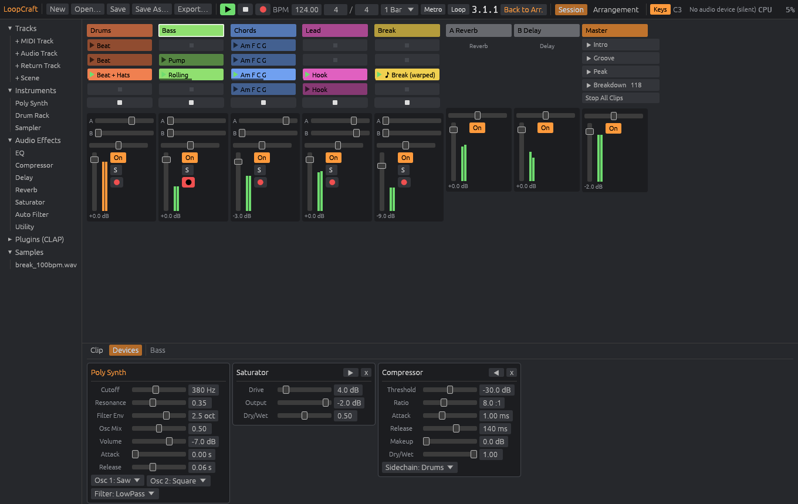
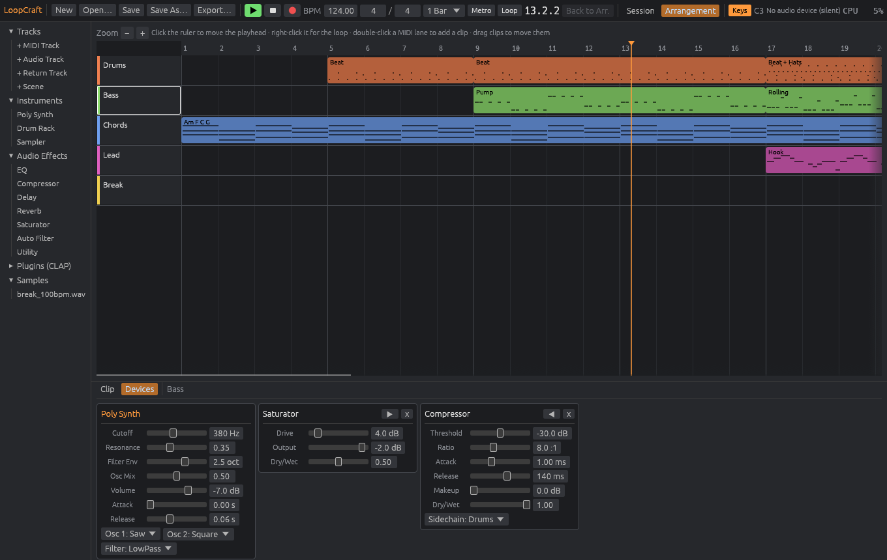

# LoopCraft

**A clip-launching digital audio workstation; an open-source, clean-room take on the Ableton Live workflow, built in pure Rust.**

Session-view clip launching, an Arrangement timeline, warped audio, built-in instruments and effects, sidechain compression, sends and returns, MIDI recording, and CLAP plugin hosting, in a native app written entirely in Rust. Open source, offline, and yours.



> **Status: v0.1, a working foundation, not a Live replacement yet.** The engine, Session and Arrangement playback, mixer, devices, MIDI recording and CLAP hosting all work and are covered by 55 automated tests. Large parts of Live (audio recording, racks, follow actions, most of the device library, control surfaces) are still on the [roadmap](docs/ROADMAP.md), which lists every feature and its status honestly.

LoopCraft is not affiliated with, endorsed by, or derived from Ableton AG. "Ableton" and "Live" are trademarks of Ableton AG and are used here only to describe the workflow LoopCraft is compatible with. See [docs/CLEAN_ROOM.md](docs/CLEAN_ROOM.md).

---

## What works today

**Session view**
- Clip grid (tracks × scenes) with quantized launching, sample-accurate to the boundary
- Scene launch, with optional per-scene tempo and time signature changes
- Launch modes: Trigger, Gate, Toggle; global and per-clip launch quantization
- Track stop buttons, Stop All Clips, empty slots act as stop buttons
- MIDI recording into a slot from the computer keyboard, looping seamlessly when done
- "Back to Arrangement" when Session clips override the timeline

**Arrangement view**
- Timeline playback of MIDI and audio clips, with looping regions
- Loop brace, click-to-seek ruler, drag clips to move them, double-click to create
- Automation lanes for volume, pan, sends and any device parameter (engine; drawing them in the UI is next)

**Audio**
- Beat-locked warping: **Stretch** (real-time WSOLA time-stretch, pitch preserved), **Repitch** (varispeed), **Off**
- Warped loops follow tempo changes, including scene tempo changes mid-song

**MIDI**
- Piano roll: add, move, resize and delete notes with grid snapping
- Per-note probability (engine), velocity
- Standard MIDI File import and export

**Instruments:** Poly Synth (2 PolyBLEP oscillators + sub, TPT state-variable filter with envelope, glide, voice stealing), Sampler, Drum Rack (8 synthesized drum voices needing no samples, or WAV pads, with choke groups)

**Audio effects:** 8-band parametric EQ, Compressor (soft knee, external sidechain), tempo-synced ping-pong Delay, Reverb, Saturator, tempo-synced Auto Filter, Utility (width, mono bass, polarity)

**Mixer:** volume, pan, mute, solo, post-fader sends to return tracks, master chain, peak meters

**Plugins:** CLAP hosting (scan, instantiate, stereo audio, note events for instruments)

**Files:** `.loopcraft` JSON projects, WAV import (any rate, auto-resampled), WAV export (16/24-bit with TPDF dither, or 32-bit float), undo/redo



## Try it

You need a recent Rust toolchain (1.85+). On Linux you also need ALSA headers (`libasound2-dev` on Debian/Ubuntu).

```sh
git clone https://github.com/loopcraft/loopcraft
cd loopcraft

# The desktop app. With no argument it opens the demo song.
cargo run --release -p loopcraft-app

# Command-line tools
cargo run --release -p loopcraft-cli -- demo ./demo
cargo run --release -p loopcraft-cli -- render demo/night-drive.loopcraft -o night-drive.wav --scenes 0:16,1:16,2:32,3:16
cargo run --release -p loopcraft-cli -- render demo/night-drive.loopcraft -o arrangement.wav --arrangement
cargo run --release -p loopcraft-cli -- info demo/night-drive.loopcraft
cargo run --release -p loopcraft-cli -- plugins
```

The demo song ("Night Drive", 124 bpm) is synthesized entirely by the engine: drums from the Drum Rack, bass ducked by the kick through sidechain compression, an auto-filtered pad on a reverb send, a lead on a delay send, and a 100 bpm drum break time-stretched to the song tempo. Its last scene drops the tempo to 118 bpm to show warping following a tempo change.

### Keyboard

| Key | Action |
|---|---|
| Space | Play / stop |
| Tab | Switch Session / Arrangement |
| A W S E D F T G Y H U J K | Play the selected MIDI track like a piano |
| Z / X | Octave down / up |
| Delete | Delete the selected note or clip |
| Ctrl+Z / Ctrl+Shift+Z | Undo / redo |
| Ctrl+D | Duplicate clip to the next slot |
| Ctrl+S / Ctrl+O / Ctrl+N | Save / open / new |

## How it's built

LoopCraft is a Cargo workspace of small crates, each usable on its own:

| Crate | What it does |
|---|---|
| `loopcraft-core` | Musical time, quantization and the project model / file format. No audio dependencies. |
| `loopcraft-dsp` | Instruments, effects and the WSOLA time-stretcher. Real-time safe. |
| `loopcraft-engine` | The audio graph: transport, clip launching, arrangement, automation, mixer. Lock-free control from the UI. |
| `loopcraft-io` | WAV and MIDI files, offline rendering, the demo song. |
| `loopcraft-plugin` | CLAP plugin hosting. |
| `loopcraft-cli` | `loopcraft` command-line tool. |
| `loopcraft-app` | The desktop app (egui + cpal). |

The audio thread never allocates, locks or frees memory: commands arrive through a wait-free ring buffer, replaced objects are shipped back to the UI thread to be dropped, and each block is split exactly at musical boundaries so launches land on the sample. Details in [docs/ARCHITECTURE.md](docs/ARCHITECTURE.md).

Run the tests with `cargo test`. The suite renders real audio and checks it: that a launch lands on beat 4 to the sample, that Stretch keeps a 220 Hz tone at 220 Hz at double speed, that a closed hat chokes an open hat, that a CLAP plugin built from the repo processes audio inside the engine.

## Contributing

Contributions are welcome; see [CONTRIBUTING.md](CONTRIBUTING.md) and pick something from the [roadmap](docs/ROADMAP.md). The one hard rule is the clean-room rule: never use Ableton's code, binaries, assets, or reverse-engineered internals.

## License

Licensed under either of [Apache License 2.0](LICENSE-APACHE) or [MIT license](LICENSE-MIT) at your option. Unless you state otherwise, any contribution you submit for inclusion is dual-licensed as above, without additional terms.

Project structure, licensing and the clean-room approach follow the model of the [ArtCraft](https://github.com/storytold/artcraft) Crafting Apps. LoopCraft is an independent project and not part of ArtCraft.
